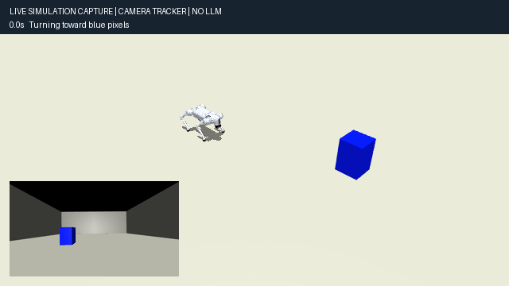
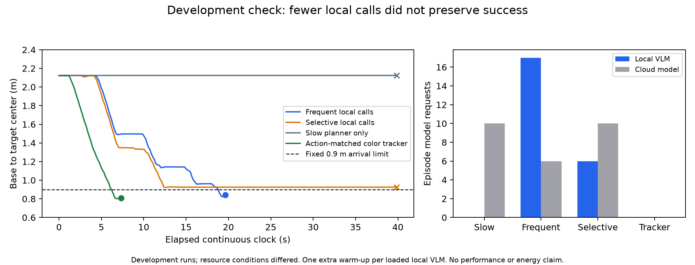

# Go2 simulation and selective-refinement development demo

A MuJoCo robot-dog demonstration, recorded model-comparison runs, and preliminary figures. **This is an engineering prototype, not a validated research improvement.**



The animation above is generated by the public camera tracker. It makes no LLM/VLM calls. The saved model runs below are separate historical experiments.

## Run the 3D simulation

Python 3.12 was used on an Apple M4 Mac. The model, meshes, and CPU ONNX walking policy are included; no API key or model download is required for this demo.

```sh
python3.12 -m venv .venv
source .venv/bin/activate
python -m pip install -r requirements.txt
# macOS requires mjpython for the interactive MuJoCo window:
mjpython simulation/demo.py
# Linux graphical desktop: python simulation/demo.py
```

Controls: **Space** starts/pauses, **M** moves the blue target, **R** resets. Mouse controls rotate/zoom the overview. The inset shows the robot camera. The simple controller follows blue pixels, turns before advancing, and stops using an idealized forward ray. The ONNX locomotion policy handles legs and balance separately.

Capture a new illustrative run with a working graphics backend:

```sh
python simulation/demo.py --headless --seconds 8 --record runs/demo.gif --snapshot runs/demo.png
```

The public demo uses independent tracking/proximity logic. It does not reproduce the private lab steering or the historical model experiments.

## Inspect saved model runs

```sh
python -m http.server 8000 --directory docs --bind 127.0.0.1
```

Open **http://127.0.0.1:8000/**. The page has play/pause buttons and sliders for actual saved camera frames. Opening the HTML directly with file:// may block its JSON fetch.

## Preliminary results



| Method | Task completed | Final distance (m) | Small-model episode calls | Cloud calls |
|---|---|---:|---:|---:|
| Adapted slow planner only | No | 2.124 | 0 | 10 |
| Frequent local model | Yes | 0.842 | 17 | 6 |
| Selective local model | No | 0.926 | 6 | 10 |
| Action-matched camera tracker | Yes | 0.810 | 0 | 0 |

Each row is **one development run**, not a success-rate estimate. These runs were recorded October 28–29, 2026 UTC. Full retained development summaries, including earlier variants and failed outcomes, are in [results/development-runs.json](results/development-runs.json). The table uses v3 frequent/selective, the isolated slow-only control, and the final v4 action-matched tracker.

Task success required base-to-target-centre distance ≤0.9 m and speed ≤0.08 m/s for 0.5 simulated seconds, upright and collision-free, before a 40-second continuous-clock deadline. One local-model warm-up call is additional to each model's episode count. Late submitted responses are counted. Wall-time conditions were not controlled, so timing is diagnostic.

The selective run stopped at 0.9257 m: the simulation adapter's proximity stopping rule disagreed with the independent scorer. This remains a failed task. Fewer small-model calls therefore **do not establish preserved performance or total compute savings**. Selective also made more cloud calls in this pair.

A zero-model tracker completed this known-blue-target fixture. The task is useful for debugging but does not establish a need for language reasoning. No statistical, energy, hardware-robot, novelty, or publication claim is made.

## Historical model setup and reproducibility boundary

Historical planning used `gpt-4.1-2025-04-14` via the OpenAI API. Local direction updates used the quantized community conversion `mlx-community/Qwen3.5-4B-4bit`, revision `0e7ffd5c629ef7719d4cbc04069232580bfa9d9c`. The local model produced fresh visual direction updates; it was not a trained action-correction policy.

The original research runner depended on privately shared collaborator navigation/steering functions. **Those files and the container are excluded from this public release.** Consequently the saved model runs can be inspected here but cannot be reproduced in full using this repository alone. The public tracking demo is self-contained. This is not an exact reproduction of the physical lab system or a published VLA method.

## Next research work

Agree on arrival/stopping semantics; validate a competent frequent-refinement baseline; choose tasks requiring semantic reasoning; compare matched controllers and sensor access; count checking, planning, refinement, and recovery costs; freeze a protocol before repeated held-out evaluation. Prior literature comparisons require renewed verification before inclusion.

## Attribution

Development and documentation had substantial AI assistance. Public locomotion observation/action mapping is adapted from [MuJoCo-LiDAR](https://github.com/discoverse-dev/MuJoCo-LiDAR), revision `e6b879df4b96daaed30ef10fe02650d29048fa9b` (MIT, Yufei Jia). Its bundled Go2 assets derive from [MuJoCo Menagerie](https://github.com/google-deepmind/mujoco_menagerie) / Unitree (BSD notices retained). See [licenses](licenses) and [assets/manifest.json](assets/manifest.json). The walking policy's training procedure has not been independently reproduced.
